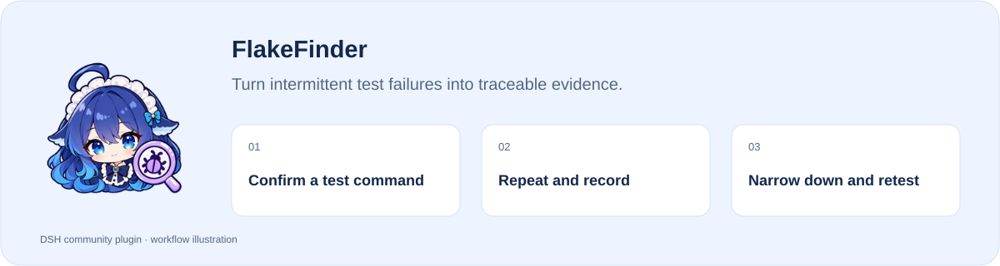

[简体中文](README.md) · **English**

# FlakeFinder

> **Turn intermittent test failures into quantified, diagnosable, traceable evidence.**

Flaky test investigation plugin for DeepSeek Harness (`>=0.2.2-rc.3`) supporting Vitest, Jest, pytest, and `node:test` with root-cause heuristics and approval-gated quarantine tracking.

[](https://www.npmjs.com/package/dsh-flakefinder) [](https://www.npmjs.com/package/dsh-flakefinder) [](https://www.npmjs.com/package/dsh-flakefinder)

**[Features](#features) · [Install](#install) · [Workflow](#start-using-it) · [Full guide](https://github.com/STARDUSTLC666/dsh-flakefinder/blob/master/docs/REFERENCE.en.md)**

<picture>
  <source media="(prefers-color-scheme: dark) and (max-width: 640px)" srcset="https://raw.githubusercontent.com/STARDUSTLC666/dsh-flakefinder/master/docs/assets/intro/workflow-en-mobile-dark.svg">
  <source media="(max-width: 640px)" srcset="https://raw.githubusercontent.com/STARDUSTLC666/dsh-flakefinder/master/docs/assets/intro/workflow-en-mobile-light.svg">
  <source media="(prefers-color-scheme: dark)" srcset="https://raw.githubusercontent.com/STARDUSTLC666/dsh-flakefinder/master/docs/assets/intro/workflow-en-dark.svg">
  
</picture>

## Features

| Pillar | Capabilities |
| :--- | :--- |
| **Multi-Runner Support** | Supports Vitest, Jest, pytest, and `node:test` with upward monorepo resolution and automatic workspace `.venv` detection |
| **Resilient Run Controls** | Targeted `testName` filters, early-stop modes (`until-flaky` / `verify-fix`), 1–4 worker concurrency & reproducible order shuffling (`shuffle`/`seed`) |
| **Root-Cause Diagnostics** | Deduplicates redacted stack traces, renders pass/fail timelines, infers 6 root-cause patterns (cold-start, state-leak, timeout-race, order-dependent, teardown-crash, intermittent) & reports 95% confidence bounds |
| **Workspace Quarantine** | Keeps per-workspace history, cross-checks `.flakefinder.json` quarantine lists, surfaces Top-N hotspots & stale reminders, and gates writes behind explicit approval prompts |

## Install

Open **Plugins** in the DSH desktop app and install `dsh-flakefinder`, or use the CLI:

```bash
dsh plugin --profile desktop add dsh-flakefinder
```

For the web profile, replace `desktop` with `web` and restart DSH. Requires DSH `>=0.2.2-rc.3`.

## Start using it

1. **Target the suspect test**: Name the intermittent test file or case inside your repository session.
2. **Repeat & capture evidence**: Run 10–20 iterations to quantify failure rates, stack clusters, and timing deltas.
3. **Fix or quarantine**: Patch timing/state issues from root-cause hints, or approve adding the case to `.flakefinder.json` while fixing.
4. **Verify & clear**: Re-run the exact loop after fixing and remove the test from quarantine once green.

### Ready-to-copy prompts

- **Reproduce flakiness**: `test/checkout.spec.ts fails sporadically in CI — repeat just that file 15 times, report the failure rate, and summarize what differs on failed runs.`
- **Check flaky hotspots**: `Show the recorded flaky test history and current quarantine list for this repo.`
- **Verify & clear**: `Re-run that test 20 times after my timer cleanup fix, and remove it from quarantine once all runs pass.`

## Before you start

- Repeated runs execute real project test commands; non-reproduction does not guarantee zero flakiness.
- Full configuration, tools, and troubleshooting: [full reference](https://github.com/STARDUSTLC666/dsh-flakefinder/blob/master/docs/REFERENCE.en.md).

## Plugin updates

Check updates at the bottom of native plugin details. Automatic checks are on by default; **automatic installation is off**. Suite-managed components update with their bundle.

## Documentation & feedback

- [Full usage, configuration and limits](https://github.com/STARDUSTLC666/dsh-flakefinder/blob/master/docs/REFERENCE.en.md) · [Release notes](https://github.com/STARDUSTLC666/dsh-flakefinder/blob/master/CHANGELOG.md) · [Validation history](https://github.com/STARDUSTLC666/dsh-flakefinder/blob/master/docs/VALIDATION.md)
- Stars, [Issues](https://github.com/STARDUSTLC666/dsh-flakefinder/issues), and [PRs](https://github.com/STARDUSTLC666/dsh-flakefinder/pulls) are welcome (strip credentials first).

## License

[MIT](https://github.com/STARDUSTLC666/dsh-flakefinder/blob/master/LICENSE)

<a id="what-it-does"></a>
<a id="requirements-and-configuration"></a>
